# 東西方商人 24 條生意經
*2500 年沒變的規律*

> **只講歷史與經營原理，不構成任何投資建議**

## 如何使用

- 每一條原則配一位東方商人和一位西方商人：先講他們做了什麼，再引一句原始史料，標出處和可信度。
- 「奧派的讀法」只是一種視角，後面附一句其他學派的不同看法，供你自己判斷。
- 「今天怎麼用」只寫通用的經營思路，不涉及任何買賣時點、個股或投資建議。
- 每位商人都有對應的視頻（YouTube），可以先讀文字，再看片子。
- 可以按順序讀，也可以挑你正在面對的問題直接翻到那一條。

## 出處與可信度

- 引文全部取自我們製作視頻時保存的原始文本（維基文庫、互聯網檔案館掃描件、公有領域百科與傳記），構建時程序逐字比對：每一句引文都必須原樣出現在保存的史料中（標點不計，省略處用「……」）。
- 外文引文保留原文，「大意」是本書的譯述，不是原文。中文古籍保留原文，英文版的譯文同樣是本書的譯述。
- 可信度：★★★ 正史、當事人自己的文字或官方文獻；★★ 後人記載、百科全書、傳記；★ 存疑或多為傳說。★ 的內容不當作史實，只用來說明道理。
- 現代研究給出的年份、數字與舊史料不一致時，正文以註釋說明，不替史料改字。
- 關於羅斯柴爾德家族：這個家族長期被反猶陰謀論歪曲。本書只引 1905 年《猶太百科全書》與 1911 年版《大英百科全書》的事實記載，不採用「滑鐵盧搶先得消息發大財」等被證偽的說法。

## 第一部分 · 看懂週期與時機

### 01. 物極必反

**價格貴到頂會轉賤，賤到底會轉貴；瘋狂的頂點，往往就是轉折點。**

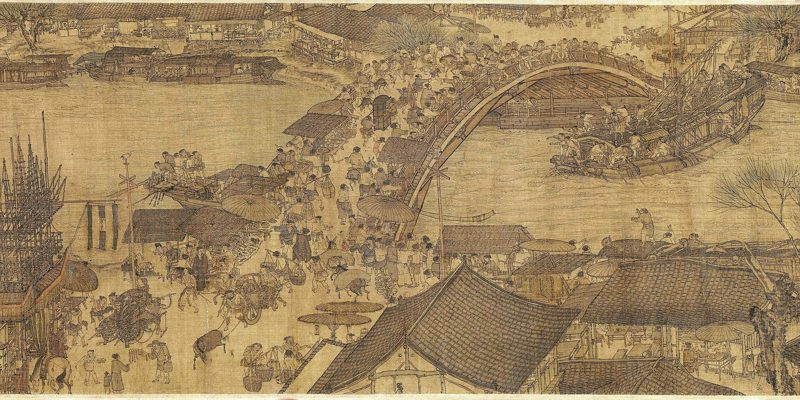

**東 · 計然**（春秋末 · 越國）

越王勾踐困在會稽時任用的謀士，留下一套不到兩百字的經營之策，范蠡後來拿去治家。

> 貴上極則反賤，賤下極則反貴。
>
> — 《史記·貨殖列傳》 · ★★★ 正史 / 當事人原文 / 官方文獻

▶ 視頻: https://youtu.be/xh9u-mRDxoc

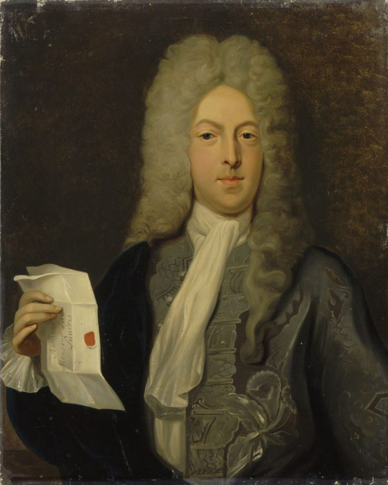

**西 · 約翰·勞**（1716–1720 · 巴黎）

蘇格蘭人，在法國辦銀行、發紙幣、組建壟斷外貿的「印度公司」，股價在 1719 年衝上頂峰後崩潰。

> In December 1719 it was at its height. The shares had then amounted to 20,000 livres, forty times their nominal price. A sort of madness possessed the nation. Men sold their all and hastened to Paris to speculate.
>
> 大意：1719年12月達到頂峰：股價漲到2萬里弗爾，面值的四十倍；全國陷入瘋狂，人們變賣一切去巴黎投機
>
> — 1911 Encyclopædia Britannica, 'Law, John' (Vol. 16, by Francis Watt) · ★★ 後人記載 / 百科 / 傳記

▶ 視頻: https://youtu.be/h2YUJ7sRSGw

**奧派的讀法（一種視角）**: 價格是買賣雙方的信號。信用和紙幣大量擴張時，信號被放大、被扭曲，人們以為是真實需求，頂點之後的回落是對錯誤投資的清算。

另一種看法：凱恩斯學派更強調需求和信心的波動，認為崩盤之後需要政府穩定需求，而不只是等市場自己出清。

**今天怎麼用**: 給自己賣的產品和買的原料定一個合理價格區間；行情異常火熱時，先檢查訂單是不是真實的，再決定要不要擴產。

*注：「貴出如糞土，賤取如珠玉」也出自計然，常被誤記為范蠡的話。約翰·勞一集的數字取自 1911 年版大英百科，現代研究給出的峰值較低。*

### 02. 人棄我取，人取我與

**別人拋售時接手，別人搶購時供應；前提是你手裡真有餘力。**

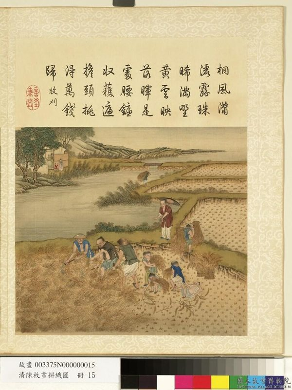

**東 · 白圭**（戰國 · 魏文侯時）

豐收時買進糧食、賣出絲漆，蠶繭上市時買進帛絮、賣出糧食，被司馬遷稱為「天下言治生」的祖師。

> 故人棄我取，人取我與。
>
> — 《史記·貨殖列傳》 · ★★★ 正史 / 當事人原文 / 官方文獻

▶ 視頻: https://youtu.be/uLmBWmJJ7sQ

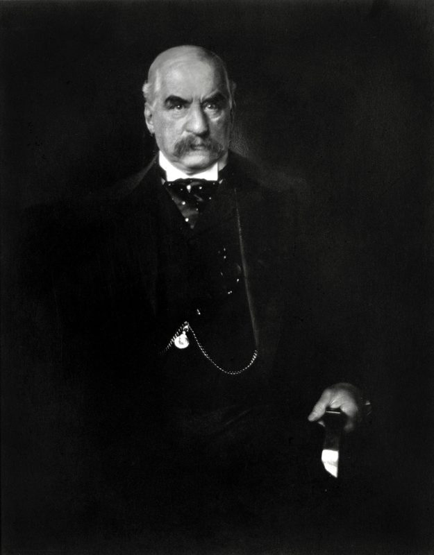

**西 · J·P·摩根**（1907 · 紐約）

1907 年恐慌中，交易所借款利率漲到 125%，人人都在收回資金；摩根和交易所主席出面，促使銀行放出 2,500 萬美元。

> On Thursday, October 24th, panic swept over the Stock Exchange. ... brought the rate for Stock Exchange demand loans up to 125 per cent.; before the day was over, however, personal intervention of the president of the Stock Exchange and of Mr. J. P. Morgan with the banks caused release of $25,000,000
>
> 大意：10月24日（週四）交易所恐慌，證券交易所活期借款利率升至125%；當天交易所主席和摩根出面，促銀行放出2,500萬美元
>
> — Alexander Dana Noyes, Forty Years of American Finance (New York: Putnam, 1909), Internet Archive OCR (fortyyearsofamer00noyeuoft), excerpts 1895/1901/1907 · ★★ 後人記載 / 百科 / 傳記

▶ 視頻: https://youtu.be/NpiFyxMdu-g

**奧派的讀法（一種視角）**: 在別人恐慌時有餘錢，靠的是平時少花、多儲蓄。儲蓄是逆週期行動的本錢，不是運氣。

另一種看法：1907 年後美國建立了聯邦儲備體系，主流觀點認為危機時的「最後貸款人」應當是公共機構，而不是一位私人銀行家。

**今天怎麼用**: 在淡季、冷門品類或沒人願意接的活裡提前做準備；同時留足現金，別人收縮時你才有能力接單。（只講經營，不是投資建議）

*配對強度中：白圭做的是實物買賣，摩根調動的是銀行資金；相同的是「逆著人群行動」。1907 年救市還有清算所、財政部和其他銀行家出力，不宜全歸摩根。*

### 03. 看變化先到哪裡

**同一個變化，不會同時到達每一個人；先看清它從哪裡開始、往哪裡傳。**

**東 · 白圭**（戰國 · 魏文侯時）

同時代的李克想把土地產出挖到最大，白圭卻把心思放在觀察時勢的變化上。

> 李克務盡地力，而白圭樂觀時變
>
> — 《史記·貨殖列傳》 · ★★★ 正史 / 當事人原文 / 官方文獻

▶ 視頻: https://youtu.be/uLmBWmJJ7sQ

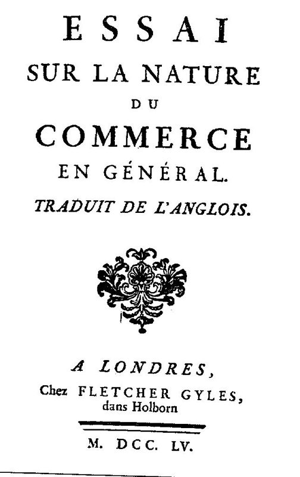

**西 · 理查德·坎蒂隆**（18 世紀初 · 巴黎、倫敦）

在巴黎開銀行的商人，後來寫出《商業性質概論》。他追問：新增的錢先流到誰手裡，再怎樣一步步推高物價。

> le Propriétaire de ces Mines, les Entrepreneurs, & tous ceux qui y travaillent, ne manqueront pas d’augmenter leurs dépenses à proportion des richesses & des profits qu’ils feront
>
> 大意：坎蒂隆：發現金銀礦後，礦主、企業主和所有在礦上幹活的人，都會按收益增加開支
>
> — Cantillon, Essai sur la nature du commerce en général (1755), II.6 · ★★★ 正史 / 當事人原文 / 官方文獻

▶ 視頻: https://youtu.be/w7vWXLMW4zk

**奧派的讀法（一種視角）**: 這就是後人所說的「坎蒂隆效應」：新錢從一個入口進入經濟，離入口近的人先受益，拿固定收入、離入口遠的人最後才感到物價上漲。

另一種看法：貨幣主義者更關心貨幣總量與總體物價的關係，認為分配路徑的差異在長期影響較小。

**今天怎麼用**: 行業裡出現新的資金、新的政策或新的平臺時，先問：錢和流量先到誰手裡？再想自己的位置。

*配對強度中：坎蒂隆更像經濟學家而非商人，這裡引的是他的理論原文；他在約翰·勞泡沫中發財一說，DNB 記為格林轉述的「故事」（★）。*

### 04. 與時轉貨

**看準時代在換工具，寧可短期少賺，也要早一步換過去。**

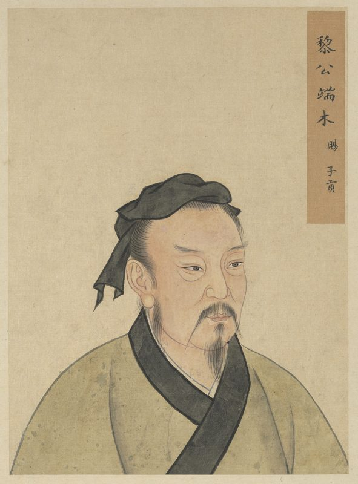

**東 · 子貢**（春秋末 · 孔門弟子）

孔子的學生，在曹、魯之間囤積販賣，是七十弟子中最富的一位。

> 子貢好廢舉，與時轉貨貲。
>
> — 《史記·仲尼弟子列傳》 · ★★★ 正史 / 當事人原文 / 官方文獻

▶ 視頻: https://youtu.be/sDdC8P0WkXY

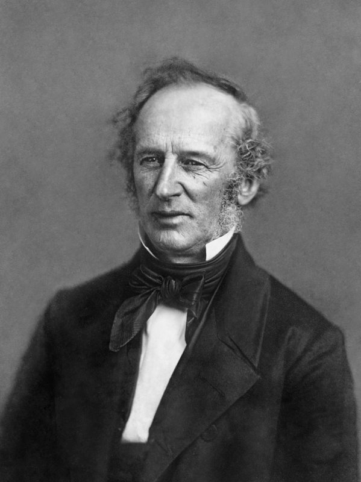

**西 · 科尼利爾斯·範德比爾特**（19 世紀 · 紐約）

他靠帆船擺渡每年能掙約 3,000 美元，卻看準蒸汽船，接受年薪 1,000 美元去給別人當汽船船長。

> though Vanderbilt had been clearing $3,000 a year by luffing and tacking, he now accepted $1,000 a year as captain of that diminutive steamboat
>
> 大意：看準蒸汽勝過風帆，他賣掉帆船，1817年起拿年薪為托馬斯·吉本斯當汽船船長，收入從3000美元降到1000美元
>
> — W. A. Croffut, The Vanderbilts and the Story of Their Fortune (Chicago: Belford, Clarke, 1886), Internet Archive OCR text · ★★ 後人記載 / 百科 / 傳記

▶ 視頻: https://youtu.be/Pt46tWaET18

**奧派的讀法（一種視角）**: 企業家的工作就是在不確定中判斷未來的需求。為學會新技術而放棄當下收入，是把「時間」投進去的資本決策。

另一種看法：熊彼特同樣重視企業家，但把技術更替稱為「創造性破壞」，更強調它對舊行業和就業的衝擊。

**今天怎麼用**: 留意正在取代你行業核心工具的新東西，抽出一部分時間和收入先去學會它；猜中過一次，不代表下一次也會中。

### 05. 擇人而任時

**會經營的人跟著時勢走，而不苛求別人；看準大勢，再找對的人去做。**

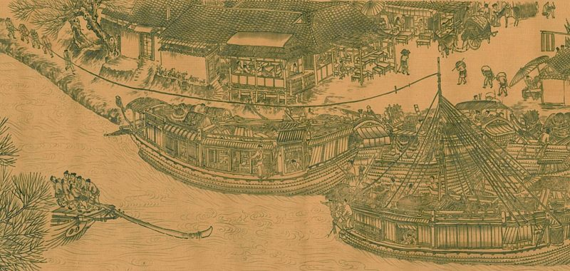

**東 · 范蠡**（春秋末 · 陶）

幫越王滅吳後離開官場，在陶地經商，十九年三次致富。司馬遷總結他的方法是「與時逐」。

> 與時逐而不責於人。故善治生者，能擇人而任時。
>
> — 《史記·貨殖列傳》 · ★★★ 正史 / 當事人原文 / 官方文獻

▶ 視頻: https://youtu.be/8UlRoj6NeTk

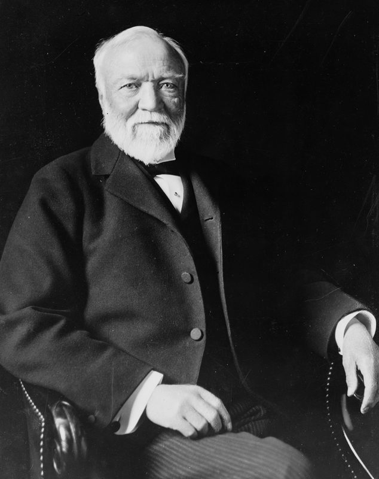

**西 · 安德魯·卡內基**（19 世紀 · 匹茲堡）

蘇格蘭織工之子，從電報員做起；他在自傳裡說，早就看出貝塞麥煉鋼法會讓鋼取代鐵。

> I had not failed to notice the growth of the Bessemer process. If this proved successful I knew that iron was destined to give place to steel; that the Iron Age would pass away and the Steel Age take its place.
>
> 大意：他看準貝塞麥煉鋼法：鋼將取代鐵，“鐵器時代”將讓位於“鋼鐵時代”
>
> — Autobiography of Andrew Carnegie (Boston: Houghton Mifflin, 1920), Project Gutenberg #17976 · ★★★ 正史 / 當事人原文 / 官方文獻

▶ 視頻: https://youtu.be/_z3ZMc3S1Wo

**奧派的讀法（一種視角）**: 沒有人能掌握全部信息，大勢只能靠一個個企業家分散地判斷。誰判斷對了，市場用利潤獎勵他；判斷錯了，用虧損糾正他。

另一種看法：產業政策派認為，鋼鐵這類基礎產業的轉型可以由國家規劃和扶持來加速，不必全靠私人判斷。

**今天怎麼用**: 每年回頭看一次：你的行業正在換什麼材料、工具或渠道？把握不大時，先找懂行的人一起做，而不是一個人硬扛。

*注：霍姆斯特德罷工（1892）中有人死亡，卡內基自述勞工界普遍認為他要負責。*

## 第二部分 · 信息與位置

### 06. 消息先送到該知道的人手裡

**看到影響全局的消息，第一件事是送到能做決定的人手裡，而不是藏起來自己用。**

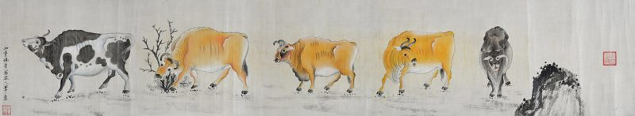

**東 · 弦高**（春秋 · 前 627 年）

鄭國商人趕牛去周都做買賣，路上撞見偷襲鄭國的秦軍。他一邊獻牛犒軍穩住對方，一邊派人快馬回國報信，鄭國因此有了防備。

> 且使遽告於鄭。
>
> — 《左傳·僖公三十三年》（含僖公三十二年傳） · ★★★ 正史 / 當事人原文 / 官方文獻

▶ 視頻: https://youtu.be/dTXHsQ3QZvQ

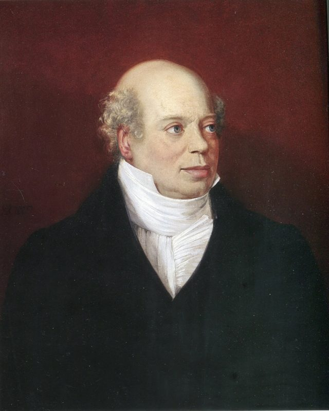

**西 · 內森·羅斯柴爾德**（1815 · 倫敦）

滑鐵盧的消息由他的代理人帶到倫敦後，他立即報告了英國政府。

> Rothschild immediately transmitted the intelligence to the government; this shows that the tradition that he gained largely by keeping the news secret is entirely mythical
>
> 大意：滑鐵盧消息由其代理人6月20日帶到倫敦，內森立即報告政府；JE稱「藏消息發大財」之說完全是神話
>
> — Jewish Encyclopedia (1901-1906), Vol. 10 (1905), 'Rothschild' (by Joseph Jacobs), jewishencyclopedia.com transcription · ★★ 後人記載 / 百科 / 傳記

▶ 視頻: https://youtu.be/YEFU9f-R4RM

**奧派的讀法（一種視角）**: 哈耶克認為市場的本質是分散知識的傳遞。及時、真實地傳遞關鍵信息，讓別人能據此調整，本身就是一種貢獻。

另一種看法：信息經濟學（如阿克洛夫、斯蒂格利茨）強調信息不對稱會讓市場失靈，因此需要披露規則和監管。

**今天怎麼用**: 發現會影響客戶、合作方或團隊的風險信號，先告訴該知道的人，再談自己的生意；長期看，這比一次信息差更值錢。

*注：流傳很廣的「內森搶先得知滑鐵盧戰果、在倫敦市場暴富」是被證偽的神話：猶太百科全書（1905）稱其「完全是神話」；現代史家考證，這一說法源自 1846 年一本署名「撒旦」的法國反猶小冊子。本書不採用。*

### 07. 選在四通八達的地方

**位置和通路決定你能接觸到多少客戶；先佔住大家必經的路口。**

**東 · 范蠡**（春秋末 · 陶）

助越滅吳後棄官經商，最後選定陶地：諸侯四通，貨物都在這裡交易，自號陶朱公。

> 朱公以為陶天下之中，諸侯四通，貨物所交易也。
>
> — 《史記·貨殖列傳》 · ★★★ 正史 / 當事人原文 / 官方文獻

▶ 視頻: https://youtu.be/8UlRoj6NeTk

**西 · 科尼利爾斯·範德比爾特**（1849–1853 · 尼加拉瓜航線）

加州淘金熱時，他取得尼加拉瓜特許，開出一條經聖胡安河和尼加拉瓜湖通往太平洋的捷徑，經營紐約到舊金山的航線。

> In 1849 he got from the Nicaraguan government a charter for a route from Greytown on the Atlantic by the San Juan river and Lake Nicaragua to San Juan del Sur, on the Pacific; and in 1851-1853 by means of this route he conducted a semi-monthly steamship line between New York and San Francisco.
>
> 大意：淘金熱中，1849年取得尼加拉瓜特許，開闢經聖胡安河和尼加拉瓜湖通往太平洋的路線，1851-1853年運營紐約至舊金山航線
>
> — 1911 Encyclopædia Britannica, 'Vanderbilt, Cornelius' (Vol. 27) · ★★ 後人記載 / 百科 / 傳記

▶ 視頻: https://youtu.be/Pt46tWaET18

**奧派的讀法（一種視角）**: 企業家利潤來自發現別人沒注意到的機會，比如一條更短的路、一個更好的集散地；一旦別人跟進，這份利潤就會被競爭攤薄。

另一種看法：經濟地理學（如克魯格曼）更強調交通成本和集聚效應本身，認為位置優勢很大程度上是歷史累積出來的。

**今天怎麼用**: 開店、選倉庫、選線上渠道，先問一句：我的客戶是不是都要經過這裡？找不到這樣的路口，就看能不能自己開一條近路。

### 08. 奇貨可居，也要算清代價

**押注別人看不上的稀缺機會，可以賺大錢；押注在權力身上，結局常常不由自己。**

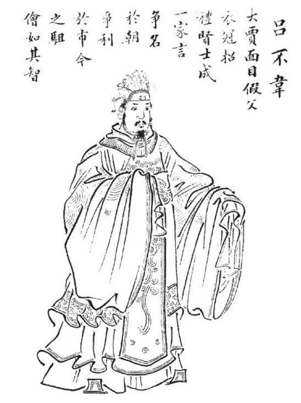

**東 · 呂不韋**（戰國末 · 陽翟大商）

在邯鄲看中做人質的秦國公子子楚，花千金為他鋪路；子楚即位後呂不韋做到丞相，最後被秦王政逼得飲鴆而死。

> 呂不韋賈邯鄲，見而憐之，曰“此奇貨可居”。
>
> — 《史記·呂不韋列傳》 · ★★★ 正史 / 當事人原文 / 官方文獻

▶ 視頻: https://youtu.be/Kd3TZvUaSDM

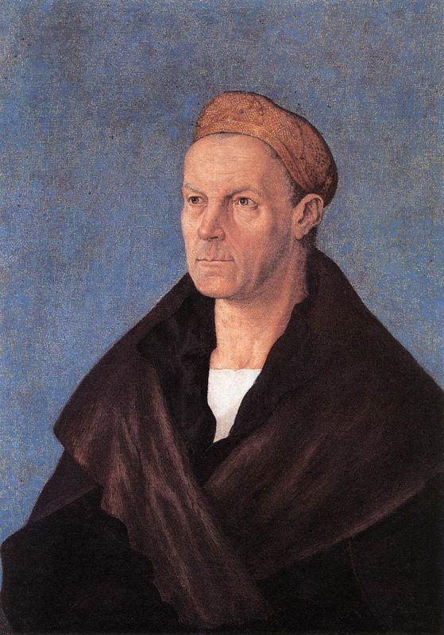

**西 · 雅各布·富格爾**（1519–1523 · 奧格斯堡）

1519 年皇帝選舉，他出了大部分經費，幫助查理五世當選。1523 年他寫信給皇帝催還款。

> Es ist auch bekannt und liegt am Tage, dass Eure kaiserliche Majestät die Römische Krone ohne meine Hülfe nicht hätten erlangen können
>
> 大意：1523年他寫信給查理五世：眾所周知，沒有我的幫助，陛下得不到羅馬皇冠
>
> — Richard Ehrenberg, Das Zeitalter der Fugger, Bd. 1 (Jena, 1896), Internet Archive OCR · ★★ 後人記載 / 百科 / 傳記

▶ 視頻: https://youtu.be/BuzoF6j1md0

**奧派的讀法（一種視角）**: 靠政治特權賺到的錢，和靠服務顧客賺到的錢性質不同；前者依賴權力的恩惠，權力一變，收益就可能被收回。

另一種看法：也有學者認為，近代早期的國家建設離不開商人融資，商人與王權的結盟推動了財政制度的發展。

**今天怎麼用**: 看出別人沒看到的稀缺機會時，同時寫下最壞結果；如果最大的客戶或靠山只有一個，想清楚它變卦時你怎麼辦。

*注：「種田十倍、珠玉百倍」的對話出自《戰國策》，《史記》未載。富格爾這封信的原件是早期新高地德語，這裡引的是埃倫貝格 1896 年書中的現代德語轉述，譯文為大意。*

## 第三部分 · 資源、信用與組織

### 09. 守住別人拿不走的資源

**真正的護城河，是一項別人拿不走、也繞不過去的資源。**

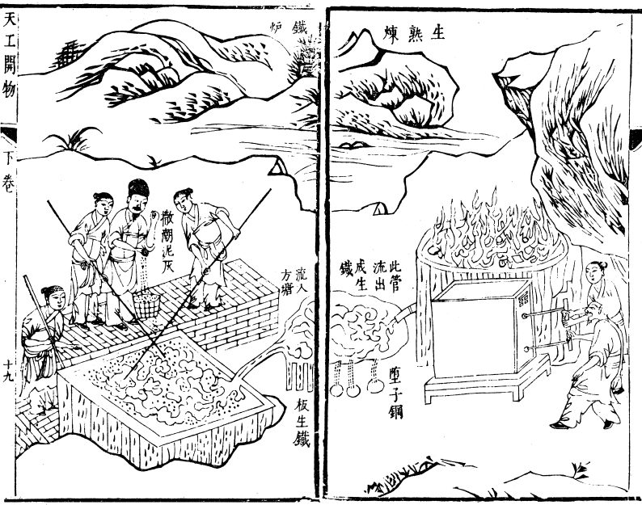

**東 · 巴寡婦清**（秦 · 巴蜀）

祖上得到丹砂礦，獨佔其利好幾代；她守住家業，秦始皇以賓客之禮相待，為她築女懷清臺。

> 其先得丹穴，而擅其利數世，家亦不訾。
>
> — 《史記·貨殖列傳》 · ★★★ 正史 / 當事人原文 / 官方文獻

▶ 視頻: https://youtu.be/_fZIc-ObEjE

**西 · 雅各布·富格爾**（1488 · 蒂羅爾）

富格爾兄弟借給蒂羅爾大公 15 萬弗羅林，條件是還清之前，施瓦茨銀礦的全部產銀以優惠價歸他們。

> indem die Brüder Ulrich, Georg und Jakob Fugger dem Erzherzoge 150000 fl, vorstreckten, bis zu deren Rückzahlung ihnen die ganze Silberausbeute der Schwazer Bergwerke zu einem für sie sehr vortheilhaften Preise überwiesen wurde.
>
> 大意：1488年三兄弟借給蒂羅爾大公15萬弗羅林，還清之前施瓦茨銀礦的全部產銀以優惠價歸他們
>
> — Richard Ehrenberg, Das Zeitalter der Fugger, Bd. 1 (Jena, 1896), Internet Archive OCR · ★★ 後人記載 / 百科 / 傳記

▶ 視頻: https://youtu.be/BuzoF6j1md0

**奧派的讀法（一種視角）**: 資源本身不等於財富，能把資源組織起來滿足需求的人，才讓它變成財富；但靠特許和獨佔維持的地位，競爭一放開就會受挑戰。

另一種看法：資源經濟學指出，依賴單一資源的財富容易受價格波動影響，也可能出現「資源詛咒」。

**今天怎麼用**: 盤點你有什麼別人拿不走的東西：一門手藝、一份獨家渠道、一批信任你的老客戶；用合同和真實的服務守住它，而不是靠關係。

### 10. 用分號網絡把信用鋪出去

**信用可以複製：同一套規矩、同一塊招牌，開到每一個需要它的城市。**

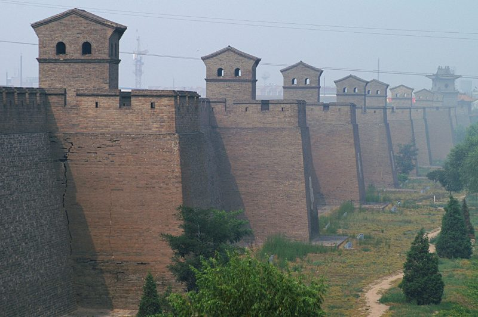

**東 · 日昇昌票號**（清 · 道光至光緒）

山西平遙的顏料行，道光初年改做匯兌，成為中國最早的票號，到同治、光緒年間居同行之首。

> 設立分號，有二十四處之多，各省幾無不有日昇昌招牌。
>
> — 《清稗類鈔·農商類》（徐珂，1917） · ★★ 後人記載 / 百科 / 傳記

▶ 視頻: https://youtu.be/SBmsxD_lXB8

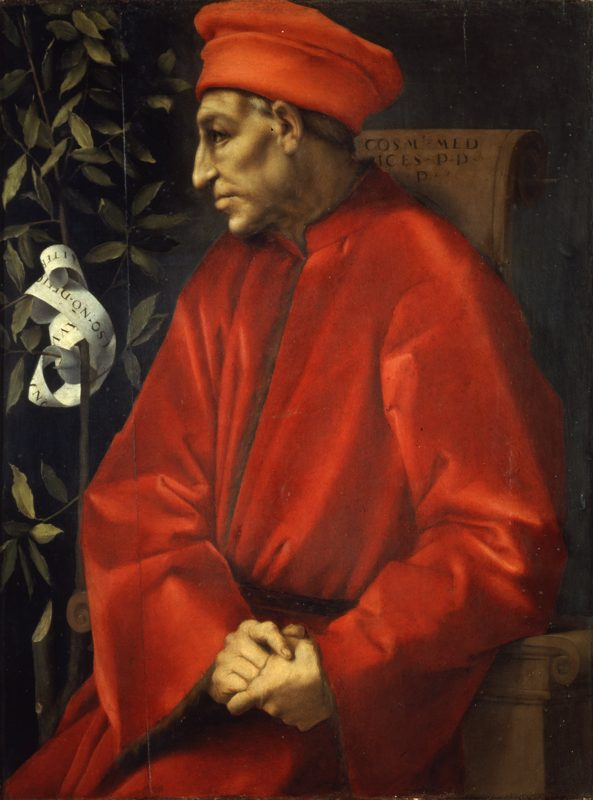

**西 · 美第奇銀行**（15 世紀 · 佛羅倫薩）

喬凡尼·德·美第奇很少參與政治，靠經商積累鉅富，在意大利和國外開設銀行。

> establishing banks in Italy and abroad, which in his successor’s hands became the most efficient engines of political power
>
> 大意：他在意大利和國外開設銀行，這些銀行到了下一代手裡，成了最有效的政治權力工具
>
> — 1911 Encyclopædia Britannica, 'Medici' (by Pasquale Villari) · ★★ 後人記載 / 百科 / 傳記

▶ 視頻: https://youtu.be/6VVdgpJ0KNs

**奧派的讀法（一種視角）**: 匯兌和存放款網絡節省了運送現銀的成本和風險，這是銀行為客戶創造的真實價值；網絡越大，越要靠嚴格的規則和準備金守住信用。

另一種看法：制度經濟學更強調網絡背後的法律與合同環境，認為缺少法律保護時，票號只能依靠同鄉和家族關係維持信任。

**今天怎麼用**: 想開分店、發展代理之前，先把規矩寫成文：怎麼記賬、怎麼結算、出錯怎麼處理。規矩能複製，信用才能複製。

*配對強度中：美第奇銀行的分行制度和複式記賬細節，我們保存的 1911 年大英百科沒有展開，這裡只引「在意大利和國外開設銀行」；銀行創立於 1397 年依據現代研究。*

### 11. 讓出力的人也分利潤

**讓核心員工分享利潤，他們就會把生意當成自己的事。**

**東 · 日昇昌票號**（清 · 道光至光緒）

出錢的是銀股，出力的是身股；夥計做滿幾年、看他可造，就給身股，三年一結賬，按股分紅。

> 以此人人各謀其私，不督責而勤，不檢制而儉。
>
> — 《清稗類鈔·農商類》（徐珂，1917） · ★★ 後人記載 / 百科 / 傳記

▶ 視頻: https://youtu.be/SBmsxD_lXB8

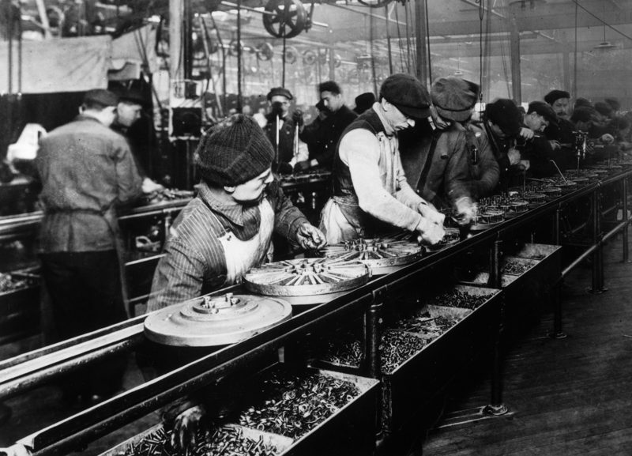

**西 · 亨利·福特**（1914 · 底特律）

1914 年推出最低日收入 5 美元的利潤分享計劃，同時把工作日從 9 小時減為 8 小時；此前為維持 1.4 萬人的隊伍，每年要招約 5.3 萬人。

> The payment of five dollars a day for an eight-hour day was one of the finest cost-cutting moves we ever made
>
> 大意：福特自評：8小時工作日付5美元，是公司做過的最好的降本舉措之一。
>
> — Henry Ford, in collaboration with Samuel Crowther, 'My Life and Work' (Garden City, NY: Doubleday, Page & Co., 1922), Project Gutenberg #7213 · ★★★ 正史 / 當事人原文 / 官方文獻

▶ 視頻: https://youtu.be/YJ17wNLNRt0

**奧派的讀法（一種視角）**: 工資是價格的一種。福特自願提高工資，是因為他算出了員工流失的真實成本，這是企業家基於本地信息的判斷，不是外部規定的結果。

另一種看法：效率工資理論（如夏皮羅—斯蒂格利茨）也解釋了高薪降流失；勞工史學者則提醒，福特的分成附帶上門審查等家長式條件。

**今天怎麼用**: 讓核心員工分享利潤，規則寫清楚、按固定週期結算、出錯有後果；再算一算人員流失的真實成本，也許加薪反而更省。

*注：福特的分成附帶「清潔與公民標準」等條件，他本人承認帶有家長式管理色彩。*

### 12. 信用首先是品格

**借錢給誰、和誰合作，先看人，再看抵押。**

**東 · 日昇昌與山西票號**（清）

山西票號重信用、不重契據，不做抵押貸款；夥計差錯一絲一毫就開除，別家也不再錄用。

> 蓋山西票號向重信用，不重契據，不做押款，此為各幫所同。
>
> — 《清稗類鈔·農商類》（徐珂，1917） · ★★ 後人記載 / 百科 / 傳記

▶ 視頻: https://youtu.be/SBmsxD_lXB8

**西 · J·P·摩根**（1912 · 美國國會聽證）

1912 年國會調查「金錢托拉斯」，律師問他商業信用是不是首先基於錢或財產，他當場這樣回答。

> Mr. Untermyer. Is not commercial credit based primarily upon money or property? Mr. Morgan. No, sir; the first thing is character. Mr. Untermyer. Before money or property ? Mr. Morgan. Before money or anything else. Money can not buy it.
>
> 大意：1912年12月19日普若委員會聽證：問商業信用是否首先基於錢或財產，摩根答“不，首先是品格……在錢或其他任何東西之前。錢買不到它。”
>
> — Money Trust Investigation, Hearings before a Subcommittee of the House Committee on Banking and Currency, Part 15 (GPO, 1913): testimony of J. Pierpont Morgan, Dec. 19, 1912, Internet Archive OCR (aeu8665.0015.001.umich.edu) · ★★★ 正史 / 當事人原文 / 官方文獻

▶ 視頻: https://youtu.be/NpiFyxMdu-g

**奧派的讀法（一種視角）**: 信用是對未來的判斷，而未來無法完全抵押。放款人真正評估的是借款人的計劃和品行，這部分信息只有當事人自己能積累。

另一種看法：同一份國會報告認為，金錢與信用的控制權正集中在少數人手裡；主流金融學也強調，抵押和信息披露能降低對個人判斷的依賴。

**今天怎麼用**: 選合作伙伴、給客戶賒賬時，先看人品和履約記錄，再看他有多少錢；自己這邊，每一筆按時付款都是在攢信用。

*注：票號「不做押款」也有代價：清末民初銀行興起、時局動盪，票號隨之衰落，日昇昌於民國初年歇業。*

### 13. 替夥伴兜底，也要有底線

**關鍵時刻替夥伴兜底能換來長久信任；但兜底要有邊界，不能替所有人的錯誤買單。**

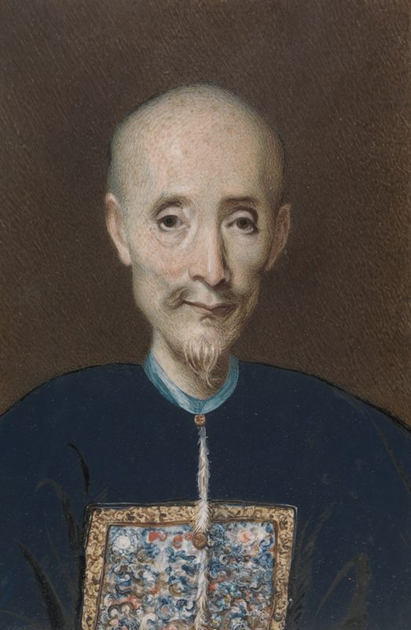

**東 · 伍秉鑑（浩官）**（清 · 廣州十三行）

十三行總商，外商最信任的中間人。同行還不起債時，他常被迫替他們還；財富也讓他成了貪官盯上的目標。

> he was often obliged to pay for debts contracted jointly when his fellow Co-hong members were unable to meet their obligations. Once he is said to have put up a million Spanish dollars for three of his partners.
>
> 大意：同行還不起債時，他常被迫替他們還；據說有一次替三個同行拿出一百萬銀元
>
> — Hummel ed., Eminent Chinese of the Ch'ing Period (1943), 'Wu Ping-chien' by Hiromu Momose · ★★ 後人記載 / 百科 / 傳記

▶ 視頻: https://youtu.be/71iKA1O9EdE

**西 · J·P·摩根**（1907 · 紐約）

1907 年恐慌中，他組織救援美國信託公司，卻拒絕救管理不善的尼克博克信託。

> "I've got to stop somewhere," he said. He was willing to let this trust company suffer the consequences of its mismanagement
>
> 大意：據1911年傳記，摩根拒絕救尼克博克：“我總得在某處停下”，任由它承擔管理不善的後果
>
> — Carl Hovey, The Life Story of J. Pierpont Morgan (New York: Sturgis & Walton, 1911), ch. 'The Panic of 1907' (sympathetic biography), Internet Archive OCR (cu31924002403529) · ★★ 後人記載 / 百科 / 傳記

▶ 視頻: https://youtu.be/NpiFyxMdu-g

**奧派的讀法（一種視角）**: 替經營不善者兜底，會讓人以為犯錯沒有代價（道德風險）；讓壞賬在可控範圍內出清，市場才能把資源轉給更會經營的人。

另一種看法：主張金融穩定的學者認為，危機中一家機構倒下可能引發連鎖擠兌，因此值得有規則地救助。

**今天怎麼用**: 跨境、跨公司合作，先讓信用看得見：按時付款、在夥伴困難時伸手；同時事先寫清楚幫到什麼程度為止。

*注：伍秉鑑「世界首富」是現代媒體說法；兩千六百萬銀元的數字，原書也寫「據稱」。*

## 第四部分 · 風險與底線

### 14. 信心一倒，一天就能擠垮你

**靠借來的錢和別人的信心撐起來的規模，一旦有風聲，可能一天就散。**

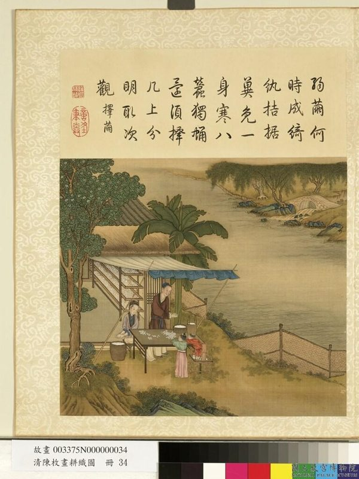

**東 · 胡雪巖**（清 · 同治光緒）

借官款週轉開阜康錢莊，分店遍佈南北，又囤積生絲和洋商對抗；絲價不振、官款遲遲不到，擠兌一來，錢莊撐不過一天就關門。

> 風聲四播，取存款者雲集潮湧，支持不經日而肆閉。
>
> — 劉體智《異辭錄》卷二 · ★★ 後人記載 / 百科 / 傳記

▶ 視頻: https://youtu.be/L9EenUOTryQ

**西 · 約翰·勞**（1720 · 巴黎）

鈔票發得越來越多，1720 年 5 月一道法令把鈔票和股票減為面值一半，雖然很快撤回，信心已經毀了。

> was obliged to consent to a decree (21st May 1720) by which the notes and consequently the shares were reduced to half their nominal value. This created such a commotion that its promoters were forced to recall it, but the mischief was done.
>
> 大意：1720年5月21日法令把鈔票和股票減為面值一半，引發軒然大波，雖被撤回但信心已毀
>
> — 1911 Encyclopædia Britannica, 'Law, John' (Vol. 16, by Francis Watt) · ★★ 後人記載 / 百科 / 傳記

▶ 視頻: https://youtu.be/h2YUJ7sRSGw

**奧派的讀法（一種視角）**: 用短期借來的錢去做長期、難變現的投資（期限錯配），平時看不出問題，一旦大家同時要錢，就會暴露。

另一種看法：戴蒙德-迪布維格模型認為，擠兌可能是一種自我實現的恐慌，健康的機構也會被擠垮，因此存款保險有其道理。

**今天怎麼用**: 擴張越快，越要看現金流和最壞情況：如果最大的一筆回款晚到三個月，你還撐得住嗎？

*注：胡雪巖一節出自劉體智《異辭錄》，作者是浙江巡撫劉秉璋之子，屬親歷或家傳見聞；阜康倒閉約在 1883 年，據現代研究。*

### 15. 大到和權力平起平坐，就危險了

**財富大到可以和公權力比肩時，最大的風險不再來自市場，而來自權力和規則。**

**東 · 沈萬三（沈秀）**（明初 · 吳興富民）

出資修築南京城牆的三分之一，又請求犒賞軍隊；朱元璋大怒要殺他，馬皇后勸下，改為發配雲南。

> 民富敵國，民自不祥。不祥之民，天將災之，陛下何誅焉！
>
> — 《明史·后妃傳·太祖孝慈高皇后馬氏》（卷113） · ★ 存疑 / 多為傳說

▶ 視頻: https://youtu.be/fQ0uilG2MqA

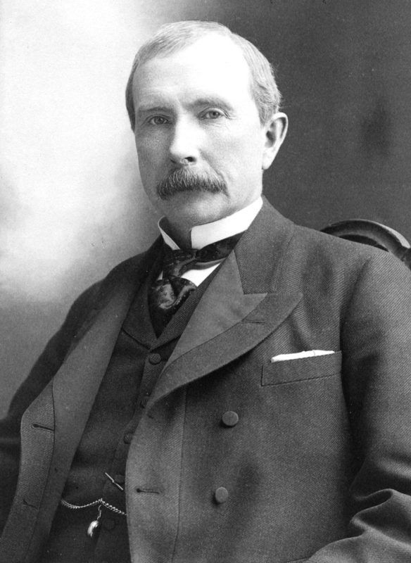

**西 · 約翰·D·洛克菲勒**（1911 · 美國最高法院）

標準石油一度控制全美絕大部分煉油能力。1911 年最高法院依據反托拉斯法維持原判，命令解散這一聯合體。

> It commanded the dissolution of the combination ... the delay of thirty days allowed for executing the decree was too short, and should be extended so as to embrace a period of at least six months.
>
> 大意：最高法院維持解散該聯合體的判決，並把執行期限從30天延長到至少6個月
>
> — Standard Oil Co. of New Jersey v. United States, 221 U.S. 1 (1911), Opinion of the Court (White, C.J.), Wikisource · ★★★ 正史 / 當事人原文 / 官方文獻

▶ 視頻: https://youtu.be/WT8eQLsAKBk

**奧派的讀法（一種視角）**: 一些奧派學者認為標準石油的優勢主要來自更低的成本，反托拉斯法有時懲罰的是效率；但兩個案例都說明，規模越大，越要把政治與法律風險當作經營風險來管。

另一種看法：主流產業組織理論認為，市場支配地位會被濫用（如塔貝爾記錄的秘密運費回扣），反壟斷執法是保護競爭的必要工具。

**今天怎麼用**: 生意越大，越要定期評估政策和監管風險；不要用錢去做本該由公權力做的事，也不要指望規則永遠對你有利。

*配對強度中：沈萬三面對的是皇帝的個人意志，標準石油面對的是法院依法判決，兩者性質不同；相同的是「規模本身會招來權力的注意」。沈萬三一事可信度★：民間「聚寶盆」等故事是傳說，這段記載本意在表現馬皇后的仁慈。*

### 16. 賬必須真實

**倒下的時候把賬本全部交出來，比賬面好看卻靠假賬撐著更值得尊重。**

**東 · 胡雪巖**（清 · 1883 年前後）

阜康錢莊倒閉後，他把全部產業賬簿交給浙江巡撫，沒有隱瞞。

> 光墉將其業產簿據獻於文莊，不稍隱匿。在落魄之中，氣概光明，曾未少貶抑。
>
> — 劉體智《異辭錄》卷二 · ★★ 後人記載 / 百科 / 傳記

▶ 視頻: https://youtu.be/L9EenUOTryQ

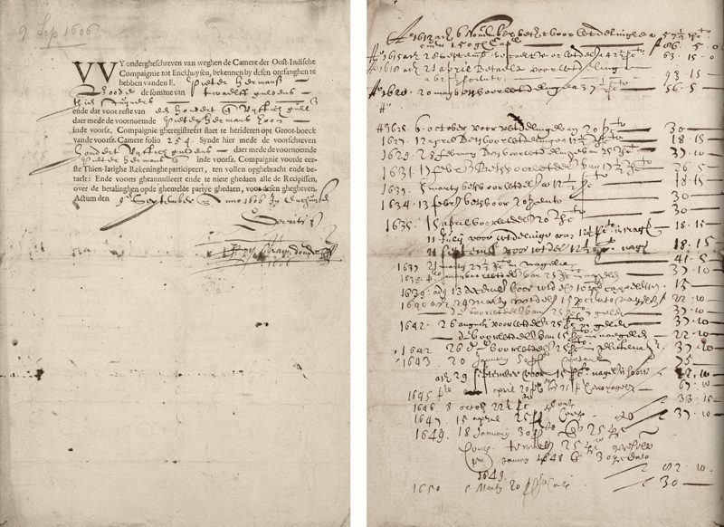

**西 · 荷蘭東印度公司**（1602–1799 · 阿姆斯特丹）

後期的軍事和行政負擔吞噬了利潤，公司解散時已經破產；據對手的說法，它的信用能維持到最後，是因為隱瞞真相、發佈假賬。

> was bankrupt when it was dissolved in 1798, though its credit remained unshaken, largely, if its enemies are to be believed, because it concealed the truth and published false accounts.
>
> 大意：後期政治軍事負擔吞噬利潤，公司1798年解散時已破產，但據稱靠隱瞞真相、假賬維持信用
>
> — 1911 Encyclopædia Britannica, 'Dutch East India Company, The' (Vol. 8) · ★★ 後人記載 / 百科 / 傳記

▶ 視頻: https://youtu.be/l5JEkMXuTL0

**奧派的讀法（一種視角）**: 米塞斯把會計核算看作經濟計算的基礎，價格和賬目失真，經營者就無法判斷自己是在創造價值還是在消耗資本。

另一種看法：公司治理和審計研究更強調製度設計：獨立審計、信息披露和問責機制，而不只靠經營者個人的誠實。

**今天怎麼用**: 每月對一次真實的現金和應收應付，不做兩套賬；生意出問題時，先對債權人和合作方說實話。

*注：東印度公司「靠假賬維持信用」一說，1911 年版大英百科寫明是「如果相信它的對手」；同一史料也記下班達群島、安汶事件的暴力。*

## 第五部分 · 資本與規模

### 17. 把大項目拆給很多人一起扛

**一個人扛不起的大事，可以把資本和風險拆成份額，讓很多人一起承擔。**

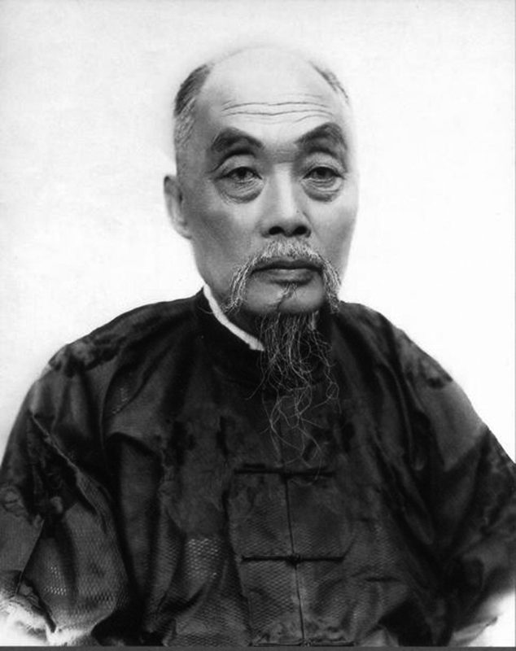

**東 · 張謇**（清末民初 · 南通）

狀元出身，受兩江總督張之洞委派籌辦紡織廠，資本一百萬兩，辦成了，這就是後來的大生紗廠。

> he appointed Chang Chien to organize a spinning and weaving mill, the capitalization of which was Tls. 1,000,000. This mission was carried out with success.
>
> 大意：他受委派籌辦一家紡紗織布廠，資本一百萬兩；這項任務辦成了。
>
> — Who's Who in China, 3rd edition (Shanghai, 1925), 'Chang Chien' · ★★ 後人記載 / 百科 / 傳記

▶ 視頻: https://youtu.be/vBfkozHTqoY

**西 · 荷蘭東印度公司**（1602 · 阿姆斯特丹）

聯省議會把幾家東印度公司合併成一家，向全國公開認購，每股 3,000 荷蘭盾，募得約 650 萬荷蘭盾。

> A capital estimated variously at a little above and a little under 6,500,000 florins, was raised by national subscription in shares of 3000 florins.
>
> 大意：約650萬荷蘭盾資本通過全國認購募集，每股3000荷蘭盾
>
> — 1911 Encyclopædia Britannica, 'Dutch East India Company, The' (Vol. 8) · ★★ 後人記載 / 百科 / 傳記

▶ 視頻: https://youtu.be/l5JEkMXuTL0

**奧派的讀法（一種視角）**: 股份制讓儲蓄者自願把資本交給他們信任的經營者；份額越清楚、退出越自由，資本就越願意流向遠期項目。

另一種看法：也有學者指出，東印度公司的成功離不開國家授予的壟斷和武裝特權，不能只歸功於股份制本身。

**今天怎麼用**: 大項目可以用合夥、分期出資的結構分攤風險；每個人出多少、分多少、怎麼退出，事先寫清楚。

*配對強度中：張謇的紗廠是官督商辦色彩的募股，東印度公司是國家特許的股份公司；相同的是「把大項目拆給很多出資人」。*

### 18. 圍繞一條產業鏈佈局

**從一個核心產品出發，把上下游一環一環接起來，比到處撒網更穩。**

**東 · 張謇**（清末民初 · 南通）

紗廠之後，他又辦了麵粉廠、油廠、鐵工廠、繅絲廠和輪船公司，把貧窮的家鄉變成了一個近代工業城鎮。

> Later he organized the Fuhsin Flour Mill, the Kwangsheng Oil Mill, the Tse-sheng Iron Works, the Fousheng Silk Filature, and the Ta Teh Steam Navigation Co.
>
> 大意：後來他又創辦了復新麵粉廠、廣生油廠、資生鐵工廠、阜生繅絲廠和大達輪船公司。
>
> — Who's Who in China, 3rd edition (Shanghai, 1925), 'Chang Chien' · ★★ 後人記載 / 百科 / 傳記

▶ 視頻: https://youtu.be/vBfkozHTqoY

**西 · 亨利·福特**（1920 年代 · 底特律）

胭脂河工廠佔地 665 英畝，有停靠湖輪的碼頭，煤從自有礦山直接運來，從原料到成品都在一處完成。

> This plant is located on the river on the outskirts of Detroit and the property covers six hundred and sixty-five acres
>
> 大意：胭脂河（River Rouge）工廠佔地665英畝，有可停靠湖輪的碼頭，煤炭由自有礦山直運——從原料到成品的一體化工廠。
>
> — Henry Ford, in collaboration with Samuel Crowther, 'My Life and Work' (Garden City, NY: Doubleday, Page & Co., 1922), Project Gutenberg #7213 · ★★★ 正史 / 當事人原文 / 官方文獻

▶ 視頻: https://youtu.be/YJ17wNLNRt0

**奧派的讀法（一種視角）**: 門格爾把生產看作由「高階財貨」一步步變成消費品的鏈條；把哪幾環放在自己手裡，是企業家對成本和風險的判斷。

另一種看法：科斯和威廉姆森的交易成本理論認為，自己做還是外包，取決於市場交易的成本；縱向一體化過度也會變得僵化。

**今天怎麼用**: 列出你生意的上下游，找出最影響質量和成本的一兩環，考慮自己做或長期鎖定；其他環節放心外包。

### 19. 薄利多銷

**不追求每一筆賺得多，而是把價格降下來，讓更多人買得起。**

**東 · 范蠡**（春秋末 · 陶）

在陶地經商，看準時機轉運貨物，只求十分之一的利潤，十九年三次致富千金。

> 候時轉物，逐什一之利。
>
> — 《史記·越王勾踐世家》 · ★★★ 正史 / 當事人原文 / 官方文獻

▶ 視頻: https://youtu.be/8UlRoj6NeTk

**西 · 亨利·福特**（1909–1921 · 底特律）

T 型旅行車從 950 美元一路降到 355 美元，年產量從約 1.9 萬輛增加到 125 萬輛。

> 1909-10 $950 18,664 cars... 1913-14 $550 248,307... 1916-17 $360 785,432... 1920-21 $440 to $355 1,250,000
>
> 大意：T型旅行車價格與產量：1909—10年950美元、18,664輛；1913—14年550美元、248,307輛；1916—17年360美元、785,432輛；1920—21年440降到355美元、125萬輛。
>
> — Henry Ford, in collaboration with Samuel Crowther, 'My Life and Work' (Garden City, NY: Doubleday, Page & Co., 1922), Project Gutenberg #7213 · ★★★ 正史 / 當事人原文 / 官方文獻

▶ 視頻: https://youtu.be/YJ17wNLNRt0

**奧派的讀法（一種視角）**: 在競爭市場裡，利潤是顧客對你服務得好的獎勵；把成本省下來讓給顧客，市場會擴大，長期利潤未必更少。

另一種看法：產業經濟學提醒，規模經濟也可能形成進入壁壘，最終降低競爭；低價策略要看是來自效率還是來自排擠。

**今天怎麼用**: 算清楚降價之後銷量要漲多少才划算；先從降低成本入手，而不是先壓價。

### 20. 東西不浪費，錢不閒著

**貨物要保管完好，錢要一直在流動；別人扔掉的邊角料，也可能是利潤。**

**東 · 計然**（春秋末 · 越國）

他講積貯之道：貨物要保持完好，錢不能閒著；容易腐壞的貨不要留，不要囤著等高價。

> 積著之理，務完物，無息幣。
>
> — 《史記·貨殖列傳》 · ★★★ 正史 / 當事人原文 / 官方文獻

▶ 視頻: https://youtu.be/xh9u-mRDxoc

**西 · 約翰·D·洛克菲勒**（1860–1870 年代 · 克利夫蘭）

早期煉油業門檻低、產量過剩，價格一跌再跌。他的出路是改進工藝、降低成本，把小廠裡被浪費的原料做成副產品。

> The price went down and down until the trade was threatened with ruin. It seemed absolutely necessary to extend the market for oil by exporting to foreign countries ... to greatly improve the processes of refining so that oil could be made and sold cheaply, yet with a profit, and to use as by-products all of the materials which in the less-efficient plants were lost or thrown away.
>
> 大意：他回憶早期煉油業：門檻低、人人湧入、產量過剩、價格一跌再跌；出路是改進工藝、降本、把被浪費的原料做成副產品
>
> — John D. Rockefeller, Random Reminiscences of Men and Events (New York: Doubleday, Page, 1909), Project Gutenberg #17090 via Internet Archive · ★★★ 正史 / 當事人原文 / 官方文獻

▶ 視頻: https://youtu.be/WT8eQLsAKBk

**奧派的讀法（一種視角）**: 資本是一段時間裡不斷週轉的結構；閒置的錢和積壓的貨，都在悄悄承擔時間的成本。

另一種看法：凱恩斯認為，在不確定時期持有現金（流動性偏好）是理性的，未必都是浪費。

**今天怎麼用**: 每季度清一次庫存和閒置設備，問三個問題：還能賣嗎？能做成別的產品嗎？能出租或轉讓嗎？

*注：洛克菲勒同時期也被批評者塔貝爾記錄了靠秘密運費回扣擠壓對手的做法，見第 15 條。*

## 第六部分 · 危機、財富與放手

### 21. 危機裡，執行力最值錢

**兵荒馬亂時，能把答應的東西按時、完整地送到，比任何口號都值錢。**

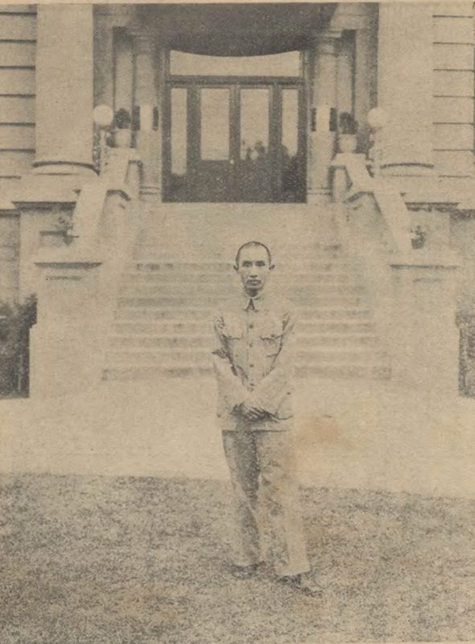

**東 · 盧作孚**（民國 · 民生公司）

抗戰時中央大學西遷，他改裝一條川江輪的一層來運學校的良種牲畜；留下的牛羊一路遊牧近一年，最後全部到達重慶。

> 從南京出發到重慶，這些大的牲畜沒有死亡一個，還添了一條小牛。
>
> — 羅家倫《抗戰時期中央大學的遷校》 · ★★★ 正史 / 當事人原文 / 官方文獻

▶ 視頻: https://youtu.be/T9D3PC-LN78

**西 · 內森·羅斯柴爾德**（1813–1815 · 倫敦）

拿破崙戰爭後期，英國政府把輸往歐洲大陸盟國和軍隊的大筆資金交給他匯送。

> England forwarded to the Continent through him in the three years 1813 to 1815 no less than £15,000,000 sterling
>
> 大意：1813至1815年，英國經內森向歐陸輸送了不少於1500萬英鎊
>
> — Jewish Encyclopedia (1901-1906), Vol. 10 (1905), 'Rothschild' (by Joseph Jacobs), jewishencyclopedia.com transcription · ★★ 後人記載 / 百科 / 傳記

▶ 視頻: https://youtu.be/YEFU9f-R4RM

**奧派的讀法（一種視角）**: 危機裡價格信號混亂、風險驟增，願意承擔不確定性並把事辦成的企業家，提供的正是別人提供不了的服務。

另一種看法：也有人指出，戰時生意往往與政府訂單和特許綁定，執行力之外，政治關係同樣關鍵。

**今天怎麼用**: 危機時，先把已經答應客戶的事情做完、做好；能在最難的時候交付，客戶會記住你很多年。

*配對強度中：盧作孚一則出自羅家倫的親歷回憶，是一件具體的事；羅斯柴爾德一則是金融匯兌，規模和性質都不同，相同的是「在戰時把東西送到」。羅斯柴爾德家族長期被反猶陰謀論歪曲，本書只引 1905 年猶太百科全書和 1911 年大英百科的記載。*

### 22. 錢賺到了，要想好去處

**賺錢是一門本事，把錢用在哪裡是另一門本事。**

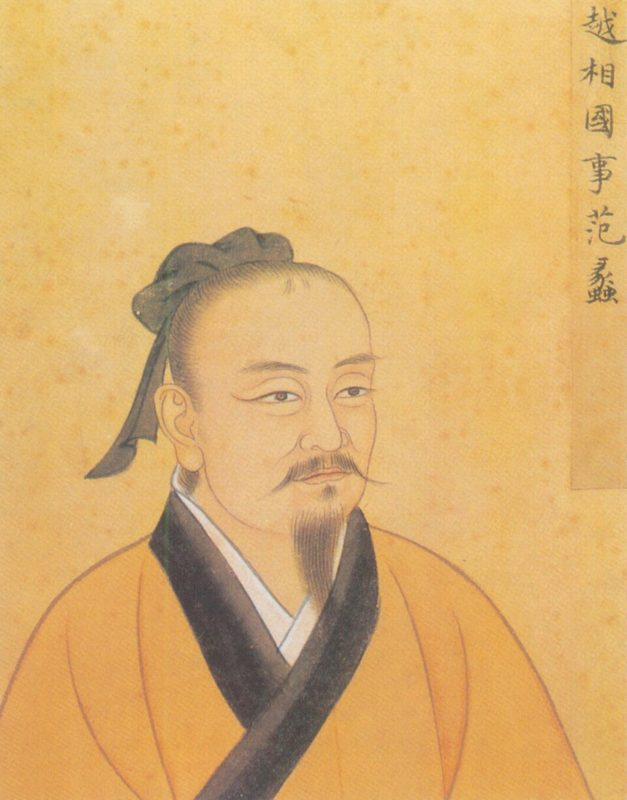

**東 · 范蠡**（春秋末 · 陶）

在陶地十九年裡三次賺到千金，兩次把財產分給貧窮的朋友和遠房兄弟。

> 十九年之中三致千金，再分散與貧交疏昆弟。此所謂富好行其德者也。
>
> — 《史記·貨殖列傳》 · ★★★ 正史 / 當事人原文 / 官方文獻

▶ 視頻: https://youtu.be/qVBmIomd8Sk

**西 · 安德魯·卡內基**（1889 · 匹茲堡、紐約）

1889 年寫下《財富》一文，晚年建了 2,811 座圖書館，生前公益捐贈約 3.5 億美元。

> There are but three modes in which surplus wealth can be disposed of. It can be left to the families of the decedents; or it can be bequeathed for public purposes; or, finally, it can be administered during their lives by its possessors.…the millionaire will be but a trustee for the poor…The man who dies thus rich dies disgraced.
>
> 大意：《財富》（1889）：剩餘財富只有三種處置方式——留給家人、遺贈公益、生前親自散出；富人應是“窮人的受託人”；“死時仍鉅富者，死得可恥”
>
> — Andrew Carnegie, 'Wealth', North American Review vol. 148 no. 391 (June 1889) — 'The Gospel of Wealth', Wikisource · ★★★ 正史 / 當事人原文 / 官方文獻

▶ 視頻: https://youtu.be/_z3ZMc3S1Wo

**奧派的讀法（一種視角）**: 自願的捐贈和私人基金會屬於公民社會，與強制的再分配不同；捐給誰、怎麼捐，是捐贈者自己的判斷和責任。

另一種看法：批評者認為，大額慈善讓少數富人決定公共事務的優先次序，不如通過稅收和民主程序分配。

**今天怎麼用**: 生意穩定後，定一個固定比例回饋員工、合作方或社區，並且自己挑選、自己跟進，而不是一次性的面子工程。

*注：卡內基一集也記下 1892 年霍姆斯特德罷工的流血衝突，他自述勞工界普遍認為他要負責。*

### 23. 在頂點給自己設退出條件

**做到頂峰時，提前想好什麼時候交棒、收縮或轉行，別等被迫離場。**

**東 · 范蠡**（春秋末 · 越 → 齊 → 陶）

助越滅吳、位至上將軍後，認為大名之下難以久居，帶上輕便珠寶乘船離開；同僚文種留下，後被賜劍自殺。

> 范蠡以為大名之下，難以久居……乃裝其輕寶珠玉，自與其私徒屬乘舟浮海以行，終不反。
>
> — 《史記·越王勾踐世家》 · ★★★ 正史 / 當事人原文 / 官方文獻

▶ 視頻: https://youtu.be/qVBmIomd8Sk

**西 · 約翰·D·洛克菲勒**（1895 · 紐約）

1895 年退出實際經營，此後把精力放在芝加哥大學和後來的洛克菲勒基金會上，比標準石油被判解散早了十多年。

> Rockefeller himself retired from active business in 1895 ... To “the University of Chicago founded by John D. Rockefeller” (in 1892) he had given, up to 1910, $24,809,666
>
> 大意：1892年創辦芝加哥大學，到1910年已捐24,809,666美元；1895年退出實際經營
>
> — 1911 Encyclopædia Britannica, 'Rockefeller, John Davison' (Vol. 23) · ★★ 後人記載 / 百科 / 傳記

▶ 視頻: https://youtu.be/WT8eQLsAKBk

**奧派的讀法（一種視角）**: 人的時間偏好和目標會隨人生階段變化；退出是重新配置自己最稀缺的資源——時間與注意力。

另一種看法：管理學的接班研究提醒，創始人退出太早或太晚都會傷害企業，關鍵在於制度化的交接。

**今天怎麼用**: 在生意最好的時候寫下退出條件：做到什麼程度交棒、什麼信號出現就收縮，並提前培養接手的人。

### 24. 親自盯生意，和幹活的人同甘共苦

**老闆生活克制、自己盯著生意，團隊才會認真；繼承者不盯生意，家業很快就會散。**

**東 · 白圭**（戰國 · 魏文侯時）

吃得簡單，克制嗜好，穿得樸素，和幹活的僮僕同甘共苦；抓住時機時，又像猛獸猛禽撲向獵物。

> 能薄飲食，忍嗜慾，節衣服，與用事僮僕同苦樂
>
> — 《史記·貨殖列傳》 · ★★★ 正史 / 當事人原文 / 官方文獻

▶ 視頻: https://youtu.be/uLmBWmJJ7sQ

**西 · 科西莫·德·美第奇**（15 世紀 · 佛羅倫薩）

父親把他培養成商人，他一輩子盯著生意；孫子洛倫佐文才遠勝於他，卻不管生意，美第奇銀行由此走下坡路。

> But his father had mainly trained him to commerce, for which he had a special liking and aptitude. He was devoted to business to the day of his death
>
> 大意：他父親主要培養他做生意；他一生到死都專注於生意
>
> — 1911 Encyclopædia Britannica, 'Medici' (by Pasquale Villari) · ★★ 後人記載 / 百科 / 傳記

▶ 視頻: https://youtu.be/6VVdgpJ0KNs

**奧派的讀法（一種視角）**: 企業家的判斷無法完全外包。所有者親自承擔盈虧、親自觀察市場，才能及時發現錯誤。

另一種看法：現代企業理論（伯利與米恩斯以來）認為，所有權與經營權分離、交給職業經理人，是大企業得以擴張的條件。

**今天怎麼用**: 每週固定抽時間看現場、看賬、聽一線員工；辦公室和自己的開銷，別比團隊高出太多。

*注：洛倫佐疏於經營一事見同一篇 1911 年大英百科條目。*

## 全書引用的史料

1. 《史記·貨殖列傳》 ★★★ https://zh.wikisource.org/wiki/史記/卷129
1. 1911 Encyclopædia Britannica, 'Law, John' (Vol. 16, by Francis Watt) ★★ https://en.wikisource.org/wiki/1911_Encyclop%C3%A6dia_Britannica/Law,_John
1. Alexander Dana Noyes, Forty Years of American Finance (New York: Putnam, 1909), Internet Archive OCR (fortyyearsofamer00noyeuoft), excerpts 1895/1901/1907 ★★ https://archive.org/details/fortyyearsofamer00noyeuoft
1. Cantillon, Essai sur la nature du commerce en général (1755), II.6 ★★★ https://fr.wikisource.org/wiki/Essai_sur_la_nature_du_commerce_en_général/Partie_II/Chapitre_6
1. 《史記·仲尼弟子列傳》 ★★★ https://zh.wikisource.org/wiki/史記/卷067
1. W. A. Croffut, The Vanderbilts and the Story of Their Fortune (Chicago: Belford, Clarke, 1886), Internet Archive OCR text ★★ https://archive.org/details/vanderbiltsstory00crofrich
1. Autobiography of Andrew Carnegie (Boston: Houghton Mifflin, 1920), Project Gutenberg #17976 ★★★ https://www.gutenberg.org/ebooks/17976
1. 《左傳·僖公三十三年》（含僖公三十二年傳） ★★★ https://zh.wikisource.org/wiki/春秋左氏傳/僖公
1. Jewish Encyclopedia (1901-1906), Vol. 10 (1905), 'Rothschild' (by Joseph Jacobs), jewishencyclopedia.com transcription ★★ https://www.jewishencyclopedia.com/articles/12909-rothschild
1. 1911 Encyclopædia Britannica, 'Vanderbilt, Cornelius' (Vol. 27) ★★ https://en.wikisource.org/wiki/1911_Encyclop%C3%A6dia_Britannica/Vanderbilt,_Cornelius
1. 《史記·呂不韋列傳》 ★★★ https://zh.wikisource.org/wiki/史記/卷085
1. Richard Ehrenberg, Das Zeitalter der Fugger, Bd. 1 (Jena, 1896), Internet Archive OCR ★★ https://archive.org/details/daszeitalterderf01unse
1. 《清稗類鈔·農商類》（徐珂，1917） ★★ https://zh.wikisource.org/wiki/清稗類鈔/047
1. 1911 Encyclopædia Britannica, 'Medici' (by Pasquale Villari) ★★ https://en.wikisource.org/wiki/1911_Encyclop%C3%A6dia_Britannica/Medici
1. Henry Ford, in collaboration with Samuel Crowther, 'My Life and Work' (Garden City, NY: Doubleday, Page & Co., 1922), Project Gutenberg #7213 ★★★ https://www.gutenberg.org/ebooks/7213
1. Money Trust Investigation, Hearings before a Subcommittee of the House Committee on Banking and Currency, Part 15 (GPO, 1913): testimony of J. Pierpont Morgan, Dec. 19, 1912, Internet Archive OCR (aeu8665.0015.001.umich.edu) ★★★ https://archive.org/details/aeu8665.0015.001.umich.edu
1. Hummel ed., Eminent Chinese of the Ch'ing Period (1943), 'Wu Ping-chien' by Hiromu Momose ★★ https://en.wikisource.org/wiki/Eminent_Chinese_of_the_Ch%27ing_Period/Wu_Ping-chien
1. Carl Hovey, The Life Story of J. Pierpont Morgan (New York: Sturgis & Walton, 1911), ch. 'The Panic of 1907' (sympathetic biography), Internet Archive OCR (cu31924002403529) ★★ https://archive.org/details/cu31924002403529
1. 劉體智《異辭錄》卷二 ★★ https://zh.wikisource.org/wiki/異辭錄/卷二
1. 《明史·后妃傳·太祖孝慈高皇后馬氏》（卷113） ★ https://zh.wikisource.org/wiki/明史/卷113
1. Standard Oil Co. of New Jersey v. United States, 221 U.S. 1 (1911), Opinion of the Court (White, C.J.), Wikisource ★★★ https://en.wikisource.org/wiki/Standard_Oil_Co._of_New_Jersey_v._United_States/Opinion_of_the_Court
1. 1911 Encyclopædia Britannica, 'Dutch East India Company, The' (Vol. 8) ★★ https://en.wikisource.org/wiki/1911_Encyclop%C3%A6dia_Britannica/Dutch_East_India_Company,_The
1. Who's Who in China, 3rd edition (Shanghai, 1925), 'Chang Chien' ★★ https://en.wikisource.org/wiki/Who%27s_Who_in_China_(3rd_edition)/Chang_Chien
1. 《史記·越王勾踐世家》 ★★★ https://zh.wikisource.org/wiki/史記/卷041
1. John D. Rockefeller, Random Reminiscences of Men and Events (New York: Doubleday, Page, 1909), Project Gutenberg #17090 via Internet Archive ★★★ https://archive.org/details/randomreminiscen17090gut
1. 羅家倫《抗戰時期中央大學的遷校》 ★★★ https://zh.wikisource.org/wiki/抗戰時期中央大學的遷校
1. Andrew Carnegie, 'Wealth', North American Review vol. 148 no. 391 (June 1889) — 'The Gospel of Wealth', Wikisource ★★★ https://en.wikisource.org/wiki/The_North_American_Review/Volume_148/Issue_391/Wealth
1. 1911 Encyclopædia Britannica, 'Rockefeller, John Davison' (Vol. 23) ★★ https://en.wikisource.org/wiki/1911_Encyclop%C3%A6dia_Britannica/Rockefeller,_John_Davison

## 圖片出處

- Along the River During the Qingming Festival (detail of original).jpg — Zhang Zeduan · Public domain · https://commons.wikimedia.org/wiki/File%3AAlong_the_River_During_the_Qingming_Festival_%28detail_of_original%29.jpg
- John Law-Casimir Balthazar.jpg — Casimir de Balthasar · Public domain · https://commons.wikimedia.org/wiki/File%3AJohn_Law-Casimir_Balthazar.jpg
- 清陳枚畫耕織圖 冊 收刈.jpg — 陳枚 · CC0 · https://commons.wikimedia.org/wiki/File%3A%E6%B8%85%E9%99%B3%E6%9E%9A%E7%95%AB%E8%80%95%E7%B9%94%E5%9C%96_%E5%86%8A_%E6%94%B6%E5%88%88.jpg
- Edward Steichen - Photographic portrait of Pierpont Morgan (1837-1913).jpg — Edward Steichen · Public domain · https://commons.wikimedia.org/wiki/File%3AEdward_Steichen_-_Photographic_portrait_of_Pierpont_Morgan_%281837-1913%29.jpg
- Cover of "Essai Sur La Nature du Commerce en Général" by Richard Cantillon.jpg — Unknown authorUnknown author · Public domain · https://commons.wikimedia.org/wiki/File%3ACover_of_%22Essai_Sur_La_Nature_du_Commerce_en_G%C3%A9n%C3%A9ral%22_by_Richard_Cantillon.jpg
- Half Portraits of the Great Sage and Virtuous Men of Old - Duanmu Ci Zigong (端木賜 子貢).jpg — anonymous · Public domain · https://commons.wikimedia.org/wiki/File%3AHalf_Portraits_of_the_Great_Sage_and_Virtuous_Men_of_Old_-_Duanmu_Ci_Zigong_%28%E7%AB%AF%E6%9C%A8%E8%B3%9C_%E5%AD%90%E8%B2%A2%29.jpg
- Cornelius Vanderbilt Daguerrotype2.jpg — Produced by Mathew Brady's studio, restored by Michel Vuijls · Public domain · https://commons.wikimedia.org/wiki/File%3ACornelius_Vanderbilt_Daguerrotype2.jpg
- Qingming shanghe tu towboat.jpg — Zhang Zeduan · Public domain · https://commons.wikimedia.org/wiki/File%3AQingming_shanghe_tu_towboat.jpg
- Andrew Carnegie, three-quarter length portrait, seated, facing slightly left, 1913 (cropped).jpg — Theodore C. Marceau · Public domain · https://commons.wikimedia.org/wiki/File%3AAndrew_Carnegie%2C_three-quarter_length_portrait%2C_seated%2C_facing_slightly_left%2C_1913_%28cropped%29.jpg
- Yang Jin Five Oxen after Han Huang.jpg — Yang Jin · Public domain · https://commons.wikimedia.org/wiki/File%3AYang_Jin_Five_Oxen_after_Han_Huang.jpg
- Nathan Mayer Rothschild by Moritz Daniel Oppenheim 1853.jpg — Moritz Daniel Oppenheim · Public domain · https://commons.wikimedia.org/wiki/File%3ANathan_Mayer_Rothschild_by_Moritz_Daniel_Oppenheim_1853.jpg
- 呂不韋.png — 馮夢龍、蔡元放 · Public domain · https://commons.wikimedia.org/wiki/File%3A%E5%90%95%E4%B8%8D%E9%9F%A6.png
- Albrecht Dürer - Jakob Fugger, the Wealthy - WGA07011.jpg — Albrecht Dürer · Public domain · https://commons.wikimedia.org/wiki/File%3AAlbrecht_D%C3%BCrer_-_Jakob_Fugger%2C_the_Wealthy_-_WGA07011.jpg
- Chinese Fining and Blast Furnace.jpg — Unknown · Public domain · https://commons.wikimedia.org/wiki/File%3AChinese_Fining_and_Blast_Furnace.jpg
- PingYaoCityWall.jpg — Peellden · Public domain · https://commons.wikimedia.org/wiki/File%3APingYaoCityWall.jpg
- Pontormo - Ritratto di Cosimo il Vecchio - Google Art Project.jpg — Pontormo · Public domain · https://commons.wikimedia.org/wiki/File%3APontormo_-_Ritratto_di_Cosimo_il_Vecchio_-_Google_Art_Project.jpg
- Ford assembly line - 1913.jpg — Unknown author · Public domain · https://commons.wikimedia.org/wiki/File%3AFord_assembly_line_-_1913.jpg
- Portrait of Houqua MET DP276513.jpg — Tingqua · CC0 · https://commons.wikimedia.org/wiki/File%3APortrait_of_Houqua_MET_DP276513.jpg
- 清陳枚畫耕織圖 冊 擇繭.jpg — 陳枚 · CC0 · https://commons.wikimedia.org/wiki/File%3A%E6%B8%85%E9%99%B3%E6%9E%9A%E7%95%AB%E8%80%95%E7%B9%94%E5%9C%96_%E5%86%8A_%E6%93%87%E7%B9%AD.jpg
- Nanjing City Wall (10150679504).jpg — Gary Todd from Xinzheng, China · CC0 · https://commons.wikimedia.org/wiki/File%3ANanjing_City_Wall_%2810150679504%29.jpg
- Portrait of J. D. Rockefeller.jpg — Published by Scientific American Compiling Dep't, New York.  · Public domain · https://commons.wikimedia.org/wiki/File%3APortrait_of_J._D._Rockefeller.jpg
- VOC aandeel 9 september 1606.jpg — VOC · Public domain · https://commons.wikimedia.org/wiki/File%3AVOC_aandeel_9_september_1606.jpg
- Zhang Jian.jpg — Unknown authorUnknown author · Public domain · https://commons.wikimedia.org/wiki/File%3AZhang_Jian.jpg
- 1935 民生實業公司 盧作孚.png — 《工讀試刊》 · Public domain · https://commons.wikimedia.org/wiki/File%3A1935_%E6%B0%91%E7%94%9F%E5%AE%9E%E4%B8%9A%E5%85%AC%E5%8F%B8_%E5%8D%A2%E4%BD%9C%E5%AD%9A.png
- Fanli (portrait) — Unknown (Ming dynasty) · Public domain · https://commons.wikimedia.org/wiki/File:Fanli.jpg

出品：SheldonTek Co., Limited 謝爾頓科技有限公司 · https://sheldontek.com · hello@sheldontek.com

> **只講歷史與經營原理，不構成任何投資建議**
